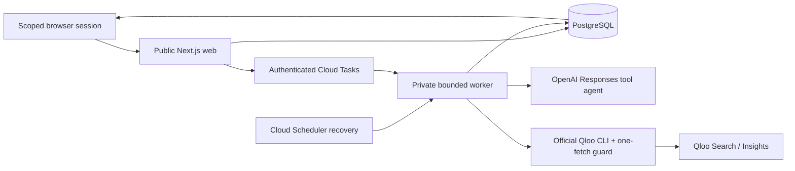

# RELAY runtime and trust boundaries

RELAY treats cultural discovery, exact consent, exchange allocation, and recorded physical custody as different authorities. The PostgreSQL state machine remains authoritative if the language model fails, returns an invented identifier, or receives instructions hidden in catalog text.

On a persistent local host, `pnpm worker` polls the same database. On request-based Cloud Run, `pnpm worker:http` processes one task and returns; it does not depend on background execution after an HTTP response. Web and worker use the same image, with different commands, permissions, environment, and database pool sizes.

## Individual access and visibility

Sample sessions intentionally allow role-play of fictional participants. Private communities start with no copies or approvals. A coordinator creates random single-use invitations with a member/coordinator role and expiry. The join consumes an invitation transactionally and creates a scoped HttpOnly browser session. Invitation/access capabilities are hashed at rest. Exact join retries are idempotent; a different join cannot reuse a consumed invitation.

The server derives the participant from the credential. A supplied member ID cannot impersonate another participant. Only the owner can list/edit/withdraw a copy, approve its trade, or confirm their part. Coordinators manage invitations, inspect copies, and record release; they cannot consent on behalf of private members. Revocation invalidates access and unreceived allocations. Received copies remain frozen for custody review.

Preferences, saved items, dismissals, identity searches, discovery reports, and associated evidence are actor-scoped. A newly confirmed cultural identity is visible only to its creator until they explicitly list a copy, which shares it inside that community. An artist reference is marked `referenceOnly` and rejected by listing commands; a separate inventory confirmation must supply an album title, including for a self-titled album.

Guest display names and physical ownership are self-reported. These capabilities are event access, not civil-identity verification, durable consumer accounts, or an account-recovery mechanism.

## Cultural identity and Qloo transport

An explicit search creates a durable actor-owned job, limited to five results. A participant selects one exact returned ID; forged, foreign, expired, duplicate, or wrong-category results are rejected. Book ISBNs, when present, identify a catalog record; edition and condition still belong to the participant's physical copy. Music lookup resolves an artist, not an album or pressing.

The pinned official harness is invoked through Node `execFile` without a shell. Search uses `api search --query ...`; ranking uses `api insights --type ... --signal-entities ... --params ...`. Known IDs go directly to Insights, avoiding the high-level rank workflow's hydration requests. The preload permits one GET on the configured official origin and expected path. It disables redirects and additional retry fetches, imposes a 12-second fetch deadline, and sits inside a 15-second child-process deadline with bounded output.

Rank input includes only verified signal IDs and at most ten eligible candidate entities in one category. A deterministic entity-ID shortlist records its coverage. The adapter accepts the actual Insights `type`/`subtype` contract, checks every ID against the requested set, rejects duplicates, and fans each ranked entity into eligible exact copies. Qloo scores are never compared across categories or represented as acceptance probabilities.

Only normalized identity/rank fields are persisted; raw provider prose, artwork, and diagnostics are discarded. Real reviewed IDs, responses, and private captures are excluded from Git. The public repository's provider fixtures are synthetic.

## Bounded model authority

The OpenAI Responses agent has four tools: inspect inventory, rank a category, inspect hypothetical exchange paths, and finish discovery with selected item IDs. It has no tool that can approve, confirm, reserve, inspect custody, settle, message, or modify inventory. The model sees voluntary favorites, catalog titles/themes, and limited physical metadata; contact details, copy notes, credentials, and hidden reasoning are excluded.

Tool schemas are strict. Calls, model steps, output tokens, elapsed time, and provider attempts are bounded. The first step must inspect inventory; evidence must exist before completion; the final permitted step is forced to finish. Invented or stale selected IDs fail validation. Catalog text is untrusted data. Arbitrary model prose is not rendered as a product claim: display explanations are rebuilt from checked evidence and current inventory.

Counterfactual path inspection adds one hypothetical approval only in memory, invokes the deterministic solver, and reports potential cycle sizes. It does not save an approval or proposal. A participant must subsequently approve the exact displayed copies and terms.

## Durability, spending, and recovery

The web transaction saves a job before sending a Cloud Tasks notification. Failed notification leaves recoverable work in PostgreSQL. Workers claim with `FOR UPDATE SKIP LOCKED` and an expiring lease token. Heartbeats extend active discovery leases. Checkpoints and final writes require the current unexpired lease, including failure writes; a stalled worker cannot overwrite its replacement.

Each provider request is reserved in an append-only usage ledger before network access, under a provider-wide PostgreSQL advisory lock. Global, community, and run limits are checked atomically. Started/failed/uncertain attempts all count; a local argument rejection can conservatively consume an allowance even when no upstream request occurred. Late reported token usage can be recorded without erasing an uncertain state. The UI distinguishes reported tokens from unreported requests.

Discovery checkpoints completed category evidence. Rank-query cache keys contain the adapter version, endpoint, output category, and exact signal/candidate IDs. Shared sample caches contain cultural evidence only; private communities use separate namespaces. In-flight claims coalesce identical rank requests. Catalog results are cached inside their community and each explicit search permits at most one upstream attempt.

Recovery is bounded to three discovery claims or two catalog claims. A crash can leave a provider outcome uncertain: RELAY promises bounded attempts and fenced publication, not exactly-once provider execution. Valid saved evidence can be reused; unknown attempts are never automatically refunded. The final publication transaction rechecks membership, preferences, eligibility, copy versions, evidence references, and live lease ownership. Cancellation prevents subsequent publication.

## Consent and settlement

Approvals bind exact give/get copies, both item versions, and immutable hub terms. Separate all-party confirmation precedes reservation. Unique active member/copy reservations supplement community-row locking and transactional validation. The solver optimizes a finite set of eligible two- to five-person cycles; deterministic exhaustion returns an error rather than an unproved optimum.

Every copy must pass coordinator inspection before atomic recorded completion. Mismatch freezes release until explicit reinspection. Withdrawal/expiry before receipt releases reservations; a repair requires new confirmation. After receipt, withdrawal or revoked membership creates a custody dispute and retains the whole allocation. The application has no automated custody-dispute resolution.

## Operation and evidence

Public health exposes only readiness and live availability. The private worker is protected by Cloud Run IAM. Provider keys exist only on the worker; the web advertises readiness through an explicit deployment flag. Cloud SQL uses a private address and certificate-validated TLS; runtime data permissions are separate from migration ownership. See [deployment operations](../deploy/gcp/README.md).

Sessions last seven days; expired access is rejected. Lifecycle expiry reconciles on workspace reads/commands. An operator still needs a retention policy for expired communities, evidence, cached results, backups, and logs. The current app sends no messages or payments and has no permanent-account recovery. These limitations are visible product scope, not implied completed integrations.

Actual PostgreSQL tests exercise lease loss, races, budgets, restart durability, authorization, forged identities, and settlement failures. Installed-harness tests replace network access to verify CLI parsing and the one-fetch guard. Independent browser sessions verify workflow and permission separation. [Evaluation](EVALUATION.md) distinguishes this implementation evidence from real human acceptance or physical handoff, which has not been measured.
